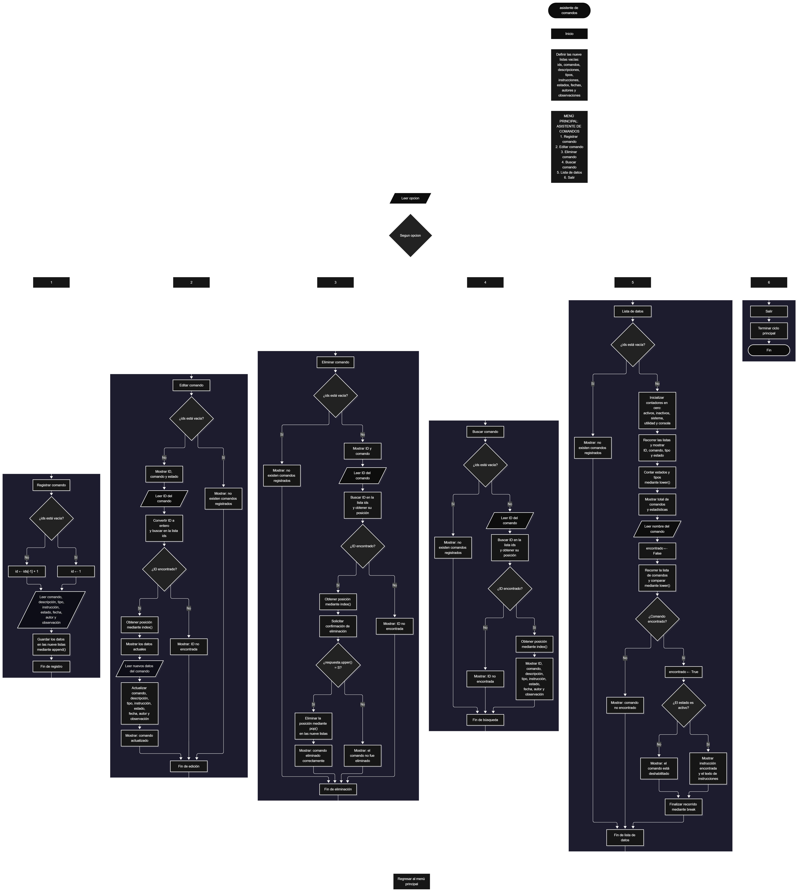

Este proyecto, llamado <b>asistente de comandos</b>, fue desarrollado en <b>python</b> como un ejercicio práctico para fortalecer la lógica de programación mediante la creación de un sistema de gestión de comandos desde la consola. El programa cuenta con un menú principal de seis opciones que permite <b>registrar, editar, eliminar, buscar y listar comandos, además de consultar sus instrucciones</b>. Cada comando almacena información como el nombre, la descripción, el tipo, la instrucción, el estado, la fecha de creación, el autor y las observaciones, utilizando nueve listas paralelas para organizar los registros durante la ejecución. También incorpora un sistema de estadísticas que permite conocer la cantidad total de comandos, distinguir entre activos e inactivos y clasificarlos según los tipos <b>sistema, utilidad y consola</b>. Durante su desarrollo se aplicaron conceptos fundamentales de programación, como variables, listas, estructuras condicionales, ciclos repetitivos, recorridos, búsquedas y operaciones para agregar, modificar y eliminar registros. Este proyecto permite poner en práctica los conocimientos adquiridos en python y sirve como base para desarrollar sistemas de administración de comandos más avanzados utilizando otros lenguajes y tecnologías.

<h2 align="center">⚙️ Funcionamiento del menú principal</h2>

### ➕ Registrar comando

La opción <b>1) registrar comando</b> permite agregar un nuevo comando al sistema. Antes de realizar el registro, el programa comprueba si la lista <b>ids</b> está vacía mediante la condición <b>len(ids) == 0</b>. Si no existen registros, asigna el identificador <b>1</b> al nuevo comando. En caso contrario, genera el siguiente identificador utilizando la expresión <b>ids[-1] + 1</b>, tomando como referencia el último ID almacenado. Después, solicita el <b>nombre del comando, descripción, tipo, instrucción, estado, fecha de creación, autor y observación</b>. Los datos se almacenan en sus respectivas listas mediante el método <b>append()</b>, manteniendo la misma posición para relacionar la información de cada registro. Finalmente, muestra el mensaje <b>"comando registrado correctamente."</b> y presenta el ID asignado. Esta operación permite incorporar nuevos comandos al sistema y mantener organizada la información almacenada.

### ✏️ Editar comando

La opción <b>2) editar comando</b> permite modificar la información de un comando previamente registrado. Primero, el programa comprueba si existen registros mediante la condición <b>len(ids) == 0</b>. Si no hay comandos almacenados, muestra el mensaje <b>"no existen comandos registrados."</b>. En caso contrario, presenta una lista con el ID, nombre y estado de cada comando. Después, solicita el identificador del registro que se desea editar mediante la variable <b>id_buscar</b>, convirtiendo el valor introducido a un número entero con <b>int()</b>. A continuación, comprueba si el identificador existe en la lista <b>ids</b> utilizando el operador <b>in</b>. Si encuentra una coincidencia, utiliza el método <b>index()</b> para obtener la posición del comando y muestra su ID y nombre actuales. Posteriormente, solicita los nuevos valores del comando, descripción, tipo, instrucción, estado, fecha, autor y observación, actualizando directamente los elementos correspondientes de las listas. El identificador original se conserva porque no se modifica durante esta operación. Finalmente, muestra el mensaje <b>"comando actualizado correctamente."</b>. Si el ID introducido no existe, presenta el mensaje <b>"id no encontrada."</b>.

### 🗑️ Eliminar comando

La opción <b>3) eliminar comando</b> permite eliminar un comando registrado mediante su identificador. Antes de comenzar, el programa comprueba si existen comandos almacenados. Si las listas están vacías, muestra el mensaje <b>"no existen comandos registrados."</b>. Si existen registros, presenta una lista con los ID y nombres de los comandos disponibles. Después, solicita el ID del comando que se desea eliminar y comprueba su existencia mediante el operador <b>in</b>. Si encuentra el identificador, utiliza <b>index()</b> para localizar su posición y muestra el ID y el nombre del comando seleccionado. A continuación, solicita una confirmación mediante la pregunta <b>"¿desea eliminar este comando? (s/n):"</b>. La respuesta se convierte a mayúsculas mediante <b>upper()</b> y se compara con el valor <b>"S"</b>. Si la confirmación es correcta, utiliza el método <b>pop(posicion)</b> en las nueve listas para eliminar los datos correspondientes al mismo registro, manteniendo la relación entre los elementos almacenados. Finalmente, presenta el mensaje <b>"comando eliminado correctamente."</b>. Si la respuesta es diferente de <b>"S"</b>, muestra <b>"el comando no fue eliminado."</b>. Si el identificador no existe, informa mediante el mensaje <b>"id no encontrada."</b>.

### 🔎 Buscar comando

La opción <b>4) buscar comando</b> permite localizar un comando registrado mediante su identificador. Primero, el programa comprueba si existen registros en la lista <b>ids</b>. Si no hay comandos almacenados, muestra el mensaje <b>"no existen comandos registrados."</b>. En caso contrario, solicita el ID del comando que se desea consultar y convierte la entrada a un número entero utilizando <b>int()</b>. Después, comprueba si el identificador se encuentra en la lista <b>ids</b> mediante el operador <b>in</b>. Si existe, obtiene su posición utilizando <b>index()</b> y presenta toda la información relacionada con el registro: <b>ID, comando, descripción, tipo, instrucción, estado, fecha, autor y observación</b>. Si el identificador no se encuentra entre los registros almacenados, muestra el mensaje <b>"id no encontrada."</b>. Esta función facilita consultar la información completa de un comando sin necesidad de recorrer manualmente todas las listas.

### 📋 Lista de datos

La opción <b>5) lista de datos</b> permite visualizar los comandos registrados, consultar estadísticas generales y buscar la instrucción de un comando mediante su nombre. Antes de comenzar, el programa comprueba si existen registros en la lista <b>ids</b>. Si no hay comandos almacenados, presenta el mensaje <b>"no existen comandos registrados."</b>. Si existen registros, inicializa cinco contadores en cero: <b>activos, inactivos, sistema, utilidad y consola</b>. Después, utiliza un ciclo <b>for</b> para recorrer las listas y mostrar el ID, nombre, tipo y estado de cada comando. Durante el recorrido, utiliza el método <b>lower()</b> para comparar los estados sin distinguir entre mayúsculas y minúsculas. Si el estado corresponde a <b>"activo"</b>, incrementa el contador de activos; si corresponde a <b>"inactivo"</b>, incrementa el contador de inactivos. También comprueba el tipo de cada comando para incrementar los contadores correspondientes a <b>"sistema", "utilidad" y "consola"</b>. Al finalizar el recorrido, presenta las estadísticas del asistente de comandos, incluyendo la cantidad total de registros mediante <b>len(ids)</b>, los comandos activos e inactivos y la clasificación por tipos.

Después de mostrar las estadísticas, el programa solicita el nombre del comando que se desea consultar mediante la variable <b>nombre_comando</b>. Inicializa la variable lógica <b>encontrado</b> con el valor <b>False</b> y utiliza otro ciclo <b>for</b> para recorrer la lista <b>comandos</b>. Durante la búsqueda, compara los nombres almacenados con el nombre introducido utilizando <b>lower()</b>, lo que permite realizar la comparación sin distinguir entre mayúsculas y minúsculas. Cuando encuentra una coincidencia, cambia <b>encontrado</b> a <b>True</b> y comprueba el estado del comando. Si está activo, muestra el mensaje <b>"instrucción encontrada"</b> y presenta el contenido almacenado en la lista <b>instrucciones</b>. Si el comando está inactivo, muestra el mensaje <b>"el comando está deshabilitado."</b>. Después de encontrar la primera coincidencia, utiliza <b>break</b> para finalizar el recorrido. Si no encuentra ningún comando con el nombre solicitado, presenta el mensaje <b>"comando no encontrado."</b>. Esta consulta muestra el texto de la instrucción almacenada, pero no ejecuta realmente el comando.

### 🚪 Salir del menú principal

La opción <b>6) salir</b> permite finalizar la ejecución del asistente de comandos. Cuando el usuario selecciona esta opción, el programa muestra el mensaje <b>"gracias por utilizar el asistente de comandos."</b> y utiliza la instrucción <b>break</b> para terminar el ciclo repetitivo <b>while True</b>. De esta manera, se interrumpe el menú principal y finaliza la ejecución del programa. Esta opción permite cerrar el sistema después de realizar las operaciones de administración de comandos.

<h2 align="center">🧠 Temas aplicados en el proyecto</h2>

### 📦 Variables

En este proyecto se utilizan variables para almacenar los datos introducidos por el usuario, controlar las opciones del menú, generar identificadores, localizar registros, administrar los estados de los comandos y calcular las estadísticas. Cada variable cumple una función específica dentro de las operaciones del sistema, permitiendo organizar y procesar la información almacenada en las listas.

🔢 **Opcion:** Almacena la opción seleccionada por el usuario en el menú principal.

🆔 **Id_comando:** Almacena el identificador que se asigna al nuevo comando durante el registro.

🔎 **Id_buscar:** Almacena el identificador introducido por el usuario para localizar un comando.

📍 **Posicion:** Guarda la posición de un comando dentro de las listas mediante el método `index()`.

📝 **Comando:** Almacena el nombre del comando que se desea registrar o actualizar.

📄 **Descripcion:** Almacena la descripción correspondiente al comando.

🏷️ **Tipo:** Almacena la clasificación del comando, como sistema, utilidad o consola.

📋 **Instruccion:** Almacena el texto de la instrucción asociada al comando.

🔘 **Estado:** Almacena el estado del comando, que puede ser activo o inactivo.

📅 **Fecha:** Almacena la fecha de creación del comando.

👤 **Autor:** Almacena el nombre del autor del comando.

📌 **Observacion:** Almacena información adicional relacionada con el comando.

🔢 **Activos:** Cuenta la cantidad de comandos cuyo estado es activo.

🔢 **Inactivos:** Cuenta la cantidad de comandos cuyo estado es inactivo.

🔢 **Sistema:** Cuenta la cantidad de comandos clasificados como sistema.

🔢 **Utilidad:** Cuenta la cantidad de comandos clasificados como utilidad.

🔢 **Consola:** Cuenta la cantidad de comandos clasificados como consola.

🔍 **Nombre_comando:** Almacena el nombre introducido por el usuario para consultar una instrucción.

✅ **Encontrado:** Variable lógica que indica si se encontró un comando durante la búsqueda por nombre.

### 🗃️ Listas

En este proyecto se utilizan nueve listas paralelas para almacenar y organizar la información de los comandos registrados. Todas comienzan vacías y aumentan o disminuyen sus elementos de manera coordinada según las operaciones realizadas. Cada posición de las listas representa un mismo comando, por lo que los datos se relacionan mediante un índice compartido. Por ejemplo, la información de un comando ubicado en la posición <b>0</b> se encuentra distribuida entre <b>ids[0], comandos[0], descripciones[0], tipos[0], instrucciones[0], estados[0], fechas[0], autores[0] y observaciones[0]</b>. Esta organización permite registrar, consultar, modificar y eliminar información manteniendo la correspondencia entre los datos de cada comando.

🆔 **Ids:** Almacena los identificadores únicos asignados a los comandos registrados.

⌨️ **Comandos:** Almacena los nombres de los comandos.

📝 **Descripciones:** Almacena las descripciones de cada comando.

🏷️ **Tipos:** Almacena las categorías o clasificaciones de los comandos.

📋 **Instrucciones:** Almacena las instrucciones asociadas a cada comando.

🔘 **Estados:** Almacena el estado de cada comando, activo o inactivo.

📅 **Fechas:** Almacena las fechas de creación de los comandos.

👤 **Autores:** Almacena los autores responsables de cada comando.

📌 **Observaciones:** Almacena información adicional de los registros.

### 🔀 Estructuras condicionales

En este proyecto se utilizan las estructuras <b>if, elif y else</b> para controlar el funcionamiento del menú principal y tomar decisiones durante las operaciones de administración de comandos. Estas condiciones permiten comprobar si existen registros antes de realizar una operación, verificar si un identificador se encuentra almacenado, determinar si el usuario confirmó una eliminación y comprobar el estado o tipo de un comando durante el cálculo de estadísticas. También permiten identificar si se encontró un nombre durante la consulta de instrucciones y mostrar mensajes diferentes según el resultado de cada comprobación. Gracias a estas estructuras, el programa puede responder de manera organizada ante las diferentes situaciones que se presentan durante su ejecución.

### 🔄 Estructuras repetitivas

En este proyecto se utilizan los ciclos <b>while</b> y <b>for</b> para controlar la repetición del menú principal y recorrer las listas que contienen los comandos registrados. El ciclo <b>while True</b> mantiene activo el menú mientras el usuario realiza las operaciones disponibles, hasta que selecciona la opción de salida y se ejecuta <b>break</b>. Por otro lado, los ciclos <b>for</b> permiten recorrer los registros para mostrar los comandos disponibles, calcular las estadísticas y buscar un nombre dentro de la lista <b>comandos</b>. Estos ciclos facilitan el procesamiento de múltiples registros sin necesidad de escribir instrucciones individuales para cada posición.

### 🎯 Métodos de listas

En este proyecto se utilizan diferentes métodos de listas para administrar los registros almacenados. El método <b>append()</b> permite agregar nuevos identificadores y datos al final de sus respectivas listas durante el registro de comandos. El método <b>pop()</b> permite eliminar un elemento de una posición determinada durante la eliminación de un comando. Por su parte, el método <b>index()</b> permite obtener la posición de un identificador dentro de la lista <b>ids</b>, facilitando el acceso a los datos correspondientes en las demás listas. Estos métodos permiten realizar las operaciones principales de administración de registros de manera organizada.

### 🔎 Búsqueda y comparación de datos

El programa utiliza el operador <b>in</b> para comprobar si un identificador se encuentra dentro de la lista <b>ids</b>. Cuando existe una coincidencia, utiliza <b>index()</b> para localizar la posición del registro. También realiza búsquedas por nombre mediante un ciclo <b>for</b>, comparando los elementos de la lista <b>comandos</b> con el valor introducido por el usuario. Para facilitar las comparaciones de texto, utiliza el método <b>lower()</b>, que convierte las cadenas a minúsculas y permite comparar nombres, estados y tipos sin distinguir entre letras mayúsculas y minúsculas.

### 🔢 Contadores y estadísticas

El sistema utiliza cinco variables contador para calcular las estadísticas de los comandos registrados. Antes de comenzar el recorrido, inicializa <b>activos, inactivos, sistema, utilidad y consola</b> con el valor cero. Después, recorre los registros mediante un ciclo <b>for</b> y utiliza estructuras condicionales para identificar el estado y el tipo de cada comando. Cuando encuentra una coincidencia, incrementa el contador correspondiente mediante el operador <b>+= 1</b>. Finalmente, muestra los resultados obtenidos junto con la cantidad total de comandos, calculada mediante <b>len(ids)</b>. Esta funcionalidad permite conocer la distribución de los comandos según su estado y clasificación.

### 🔠 Manipulación de cadenas

En este proyecto se utilizan los métodos <b>lower()</b> y <b>upper()</b> para modificar temporalmente la representación de las cadenas durante las comparaciones. El método <b>lower()</b> se aplica al comparar los nombres de los comandos, los estados y los tipos, permitiendo realizar comprobaciones sin distinguir entre mayúsculas y minúsculas. El método <b>upper()</b> se utiliza durante la confirmación de eliminación para convertir la respuesta del usuario a mayúsculas y comprobar si corresponde al valor <b>"S"</b>. Estos métodos facilitan el tratamiento de los datos de texto durante las diferentes operaciones del sistema.

<h2 align="center">¿Cómo se implementaron las operaciones crud en el proyecto?</h2>

Las operaciones <b>crud</b> se implementaron mediante las opciones del menú principal, permitiendo administrar los comandos registrados en el sistema. La operación <b>crear</b> corresponde a <b>registrar comando</b>, donde se genera un identificador y se almacenan los datos mediante el método <b>append()</b>; la operación <b>leer</b> se realiza mediante las opciones <b>buscar comando y lista de datos</b>, que permiten consultar los registros y sus instrucciones; la operación <b>actualizar</b> corresponde a <b>editar comando</b>, donde se modifican los datos de un registro mediante su posición en las listas; y la operación <b>eliminar</b> se realiza mediante <b>eliminar comando</b>, utilizando el método <b>pop()</b> para retirar los elementos correspondientes de las nueve listas. Estas operaciones utilizan variables, listas, estructuras condicionales, ciclos y métodos de Python para administrar la información almacenada temporalmente durante la ejecución del programa.

<h2 align="center">Diagrama de flujo del proyecto</h2>

<h2 align="center">🛡️ Validaciones del programa</h2>

### 📭 No existen comandos registrados

Esta comprobación se utiliza en las opciones de <b>editar, eliminar, buscar y lista de datos</b>. El programa verifica si la lista <b>ids</b> está vacía mediante la condición <b>len(ids) == 0</b>. Si no existen comandos registrados, muestra el mensaje <b>"no existen comandos registrados."</b> y evita continuar con las operaciones que necesitan información almacenada. Esta comprobación permite controlar las consultas y modificaciones cuando el sistema todavía no contiene registros.

### ❌ Identificador no encontrado

Esta comprobación se utiliza durante las operaciones de <b>editar, eliminar y buscar comando</b>. Después de solicitar el identificador al usuario, el programa utiliza el operador <b>in</b> para comprobar si el valor introducido se encuentra en la lista <b>ids</b>. Si existe, obtiene su posición mediante <b>index()</b> y continúa con la operación correspondiente. Si no encuentra coincidencias, presenta el mensaje <b>"id no encontrada."</b>. Esta comprobación permite evitar que el programa intente modificar, eliminar o consultar un registro mediante un identificador que no está almacenado.

### ⚠️ Confirmación de eliminación

Esta comprobación se utiliza en la opción <b>eliminar comando</b> antes de retirar un registro de las listas. Después de mostrar el ID y el nombre del comando seleccionado, el programa solicita una respuesta mediante la variable <b>respuesta</b>. Posteriormente, utiliza <b>upper()</b> para convertir el valor introducido a mayúsculas y comprueba si es igual a <b>"S"</b>. Si la condición se cumple, elimina el comando mediante <b>pop(posicion)</b> en las nueve listas. Si la respuesta es diferente, cancela la operación y muestra el mensaje <b>"el comando no fue eliminado."</b>.

### 🔘 Estado de los comandos

El programa utiliza los estados <b>"activo"</b> e <b>"inactivo"</b> para identificar la disponibilidad de los comandos. Durante las estadísticas, compara cada estado utilizando <b>lower()</b> y contabiliza los registros que corresponden a cada clasificación. Durante la consulta por nombre, también comprueba si el comando tiene el estado <b>"activo"</b>. Si está activo, muestra la instrucción almacenada; si está inactivo, presenta el mensaje <b>"el comando está deshabilitado."</b>. Sin embargo, el programa no restringe los valores que el usuario puede introducir durante el registro o la edición.

### 🔎 Búsqueda por nombre

Esta comprobación se utiliza en la opción <b>lista de datos</b>, cuando el programa solicita el nombre del comando cuya instrucción se desea consultar. Primero, inicializa la variable <b>encontrado</b> con el valor <b>False</b>. Después, recorre la lista <b>comandos</b> y compara los nombres mediante <b>lower()</b>. Cuando encuentra una coincidencia, cambia la variable a <b>True</b> y comprueba el estado del comando para mostrar su instrucción o indicar que está deshabilitado. Si termina el recorrido sin encontrar coincidencias, presenta el mensaje <b>"comando no encontrado."</b>. La búsqueda finaliza después de la primera coincidencia mediante la instrucción <b>break</b>, por lo que, si existen nombres duplicados, se consulta el primer registro coincidente.

### 🔢 Generación de identificadores

Durante el registro de comandos, el programa comprueba si la lista <b>ids</b> está vacía. Si no contiene elementos, asigna el identificador <b>1</b>. Si existen registros, obtiene el último identificador mediante <b>ids[-1]</b> y le suma uno para generar el siguiente valor. Esta operación permite asignar identificadores consecutivos según el último elemento almacenado. Sin embargo, si se elimina el último comando registrado, el siguiente registro puede reutilizar un identificador que ya había sido utilizado anteriormente.

### ⚠️ Opción no válida

El menú principal utiliza una estructura condicional <b>if, elif y else</b> para identificar la opción seleccionada por el usuario. Si el valor introducido no coincide con ninguna de las seis opciones disponibles, el programa ejecuta el bloque <b>else</b> y muestra el mensaje <b>"opción no válida."</b>. Después, el ciclo <b>while True</b> continúa ejecutándose y vuelve a presentar el menú principal, permitiendo que el usuario seleccione otra opción.

### ⚠️ Entradas y datos almacenados

El programa utiliza <b>int()</b> para convertir los identificadores introducidos por el usuario a números enteros durante las operaciones de edición, eliminación y búsqueda. Sin embargo, no incorpora una comprobación previa para verificar que la entrada sea numérica, por lo que un valor no válido puede generar una excepción. Tampoco comprueba si los campos de texto están vacíos ni restringe los valores introducidos para los tipos y estados. Además, los registros se almacenan únicamente en listas durante la ejecución, sin utilizar archivos o bases de datos para conservar la información después de cerrar el programa.

<h2 align="center">🎯 Objetivo del proyecto</h2>

El objetivo principal de este proyecto es fortalecer la <b>lógica de programación</b> mediante el desarrollo de un sistema de administración de comandos en <b>python</b>. A través de su construcción se busca aplicar los conocimientos adquiridos sobre variables, listas, estructuras condicionales, ciclos repetitivos, recorridos, búsquedas y métodos para manipular colecciones de datos, integrándolos para resolver un problema de manera organizada. Además, el proyecto permite comprender cómo registrar, consultar, modificar y eliminar información, administrar diferentes clasificaciones y estados, y generar estadísticas a partir de los registros almacenados. De esta manera, se establece una base para desarrollar sistemas de gestión más completos y automatizados utilizando otros lenguajes y tecnologías.

